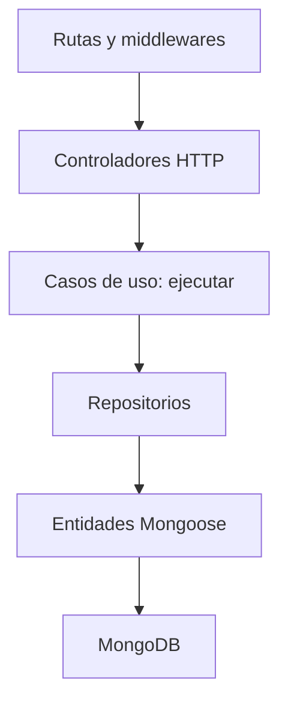

# TaskFlow · Sesión 24

Miércoles 11 de noviembre de 2026 · Seguridad JWT, bcrypt y backend completo en Render

Registrar e identificar usuarios de TaskFlow, guardar contraseñas con bcrypt mediante pre('save'), autorizar tareas por propietario y desplegar el backend organizado por casos de uso.

## Preparación previa

La reorganización por capas, las entidades, los validadores y los roles vienen preparados. El alumnado completa los puntos de seguridad para concentrar la sesión en integración y despliegue. Tener GitHub, Render y Atlas listos antes de clase.

1. Utiliza Node.js 24 LTS recomendado; el paquete admite Node 22.12 hasta 24.
2. Descomprime el ZIP y abre la carpeta que contiene package.json.
3. Ejecuta `npm ci`. Se incluyen bcrypt, Express 5, Mongoose 9, Morgan y Jest.
4. Copia `.env.example` a `.env`. Configura MONGO_DB_URI con una BD nueva de práctica, por ejemplo `taskflow_s24_bcrypt`.
5. Genera el secreto y pégalo únicamente en JWT_SECRET de .env:

```bash
node -e "console.log(require('node:crypto').randomBytes(32).toString('hex'))"
npm run dev
```

`.env` usa PORT=3000, MONGO_DB_URI, JWT_SECRET, CORS_ORIGIN=http://localhost:3000 y NODE_ENV=development. El seed crea roles, no cuentas de administrador. El registro público asigna Cliente.

Esta entrega completa TODO 1–10: `npm test` aprueba 10 pruebas en seis suites y `npm run smoke` pasa contra MongoDB real. El detalle está al final, en **Entrega individual**.

## Arquitectura aplicada

Se incluye sin modificar `arquitectura.md`, el documento de referencia del curso. Las extensiones de seguridad se documentan aquí.

| Capa | Archivo o carpeta | Responsabilidad |
|---|---|---|
| Inicio | src/server.js | Valida entorno, conecta BD, espera índices, crea roles y escucha |
| Express | src/app.js | Helmet, CORS, Morgan, JSON, archivos públicos, rutas, 404 y errores |
| Rutas | src/routes/tarea.rutas.js y autenticacion.rutas.js | Seleccionan controlador y middlewares |
| Validación HTTP | src/middlewares/ | Validadores, validar.solicitud.js y autenticar.jwt.js |
| Controladores | src/controllers/ | Adaptan HTTP y llaman casos de uso |
| Casos de uso | src/useCases/tasks/ y auth/ | Cada acción expone ejecutar; reglas de negocio |
| Repositorios | src/repositories/ | Consultan Mongoose y devuelven objetos simples |
| Entidades | src/entities/ | Esquemas; usuario.entidad.js contiene pre('save') |
| Seed | src/seeds/roles.seed.js | Administrador y Cliente sin duplicarlos |
| Interfaz | public/views/index.html y public/assets/app.js | Página mínima servida por Express, consulta /health |
| Pruebas | test/unit/ y test/requests.http | Jest y solicitudes manuales |



El middleware autentica y establece req.usuario. El controlador pasa su id al caso de uso. Los filtros del repositorio autorizan cada operación por propietario. Un rol Administrador no obtiene acceso global implícito en esta práctica.

## Conceptos esenciales

| Concepto | Comportamiento |
|---|---|
| Hash bcrypt | Se calcula dentro de pre('save') con costo 12 y salt generado por bcrypt |
| Verificación | El caso de uso de login llama bcrypt.compare(entrada, hash) |
| Autenticación | JWT válido, usuario existente y activo, rol activo |
| Autorización | propietario proviene de req.usuario.id y limita cada operación |
| JWT firmado | Payload legible, firma verificada y caducidad de 15 minutos |
| Rol inicial | Cliente se busca en el servidor; no se acepta en el registro HTTP |
| Logout | Respuesta educativa: el cliente elimina el token; una copia sigue válida hasta expirar |

### Reglas del hook

- Usar `async function ()` para que `this` sea el documento.
- Registrar el hook antes de `mongoose.model`.
- `if (!this.isModified('contrasena')) return` evita volver a generar el hash al cambiar otros campos.
- `Usuario.create()` y `documento.save()` ejecutan el hook. `findOneAndUpdate()`, `updateOne()` e `insertMany()` no son la vía de guardado de credenciales de esta práctica.
- Para una futura función de cambio de contraseña: cargar al usuario, asignar la contraseña nueva y ejecutar `save()`. No se añade ese endpoint en esta sesión.
- Validar contraseña antes del hash: mínimo 15 caracteres y máximo 72 bytes UTF-8, tanto en HTTP como en la entidad. bcrypt usa un límite en bytes; los acentos y emojis pueden ocupar varios bytes.
- No volver a generar hashes desde el caso de uso, no escribir contraseñas en logs y no mostrarlas en respuestas. La propiedad `contrasena` almacena el hash tras el guardado; su nombre no implica texto plano en MongoDB.

Las respuestas se construyen con objetos públicos del repositorio. `select:false` y la transformación JSON de la entidad son protecciones adicionales. Sólo buscarCredenciales recupera el hash, para consumo interno del login.

Este ejemplo no implementa refresh, revocación de JWT, MFA, recuperación de contraseña ni confirmación de correo. HTTPS protege el transporte. CORS no sustituye autenticación ni permisos. El limitador en memoria es didáctico y requiere un store compartido en varias instancias.

## Pruebas y evidencias

| Prueba | Resultado esperado |
|---|---|
| Usuario.create / doc.save nuevo | Persiste hash bcrypt con costo 12 |
| Misma contraseña en dos usuarios | Hashes distintos |
| Cambiar nombre y save | Hash igual, sin volver a generarlo |
| Cambiar contraseña y save | Hash distinto; compare acepta la nueva |
| Más de 72 bytes, incluidos acentos | 400 HTTP o ValidationError en entidad |
| Registro válido / duplicado | 201 sin contrasena / 409 |
| Body con rol, estado o propietario | 400 en la operación correspondiente |
| Login válido / credenciales erróneas | 200 con token / 401 |
| Usuario o rol inactivo | 401 en login o middleware |
| JWT ausente, alterado o vencido | 401 |
| Ana crea, consulta y modifica | 201 / 200 / 200 |
| Bruno lista y lee/modifica/borra el id de Ana | No aparece / 404 / 404 / 404 |
| /me válido / sin token | 200 sin contrasena / 401 |
| Logout y reutilización del token en herramienta | 200; el token sigue válido hasta expirar |
| Reinicio o seed repetido | Dos roles únicos, sin cuentas admin nuevas |
| JSON mal formado / demasiado grande | 400 / 413 |
| Más de 20 intentos auth por IP en 15 min | 429; esperar ventana |
| /health en Render | 200 con BD conectada |

```bash
npm run test:core
# Al completar TODO 9–10:
npm test
# Con API conectada a BD de práctica, en otra terminal:
npm run smoke
```

Jest ejecuta 10 pruebas en seis suites de entidades, rutas, controladores, casos de uso, middlewares y seeds. Las escrituras y consultas de BD se simulan. En las pruebas de hash sí se ejecutan `create()`, `save()` y el hook real de Mongoose; no se reemplaza el hash por un mock. Estas pruebas no verifican el índice único contra un servidor real.

Smoke usa HTTP real y requiere API y MongoDB conectados. Crea dos cuentas y elimina su tarea al terminar; conserva las cuentas ficticias. Sólo usar en una BD de práctica. PowerShell: `$env:BASE_URL="https://TU-SERVICIO.onrender.com"; npm run smoke`. Bash: `BASE_URL=https://TU-SERVICIO.onrender.com npm run smoke`.

Para token vencido, Jest firma uno con expiración negativa. También puedes esperar 15 minutos con un token normal; no elimines la validación del backend. Oculta tokens, URI, secreto y contraseñas en las capturas.

## Documentos de consulta

Lee CONTRATO_API.md para rutas, campos y compatibilidad. Lee DEPLOY_RENDER.md para publicar. El contrato de autenticación usa nombre, correo y contrasena.

## Código base del alumnado

TODO 1–8 durante clase y TODO 9–10 fuera de clase. test:core comprueba Parte A; npm test añade /me.

---

# Entrega individual · S24

**Alumno:** José Luis Almendarez González · **Materia:** Diseño de aplicaciones y servicios web · **Profesor:** Uriel Robles Gil

## Qué implementé

| TODO | Archivo | Implementación |
|---|---|---|
| 1 | `.env` (no versionado) | `MONGO_DB_URI` a la BD de práctica `taskflow_s24_bcrypt`, `JWT_SECRET` de 32 bytes aleatorios generado con `crypto.randomBytes` |
| 2 | `src/entities/usuario.entidad.js` | `pre('save')` con `async function`: si `contrasena` no cambió, sale; si cambió, `bcrypt.hash(contrasena, 12)` |
| 3 | `src/useCases/auth/registrar-usuario.caso-uso.js` | Rechaza correo repetido con 409, busca el rol **Cliente** en el servidor y llama a `usuarios.crear`; el hash lo genera el hook |
| 4 | `src/useCases/auth/iniciar-sesion.caso-uso.js` | `buscarCredenciales`, `bcrypt.compare`, usuario y rol activos; responde `accessToken` (15 min, HS256, issuer y audience), `tokenType`, `expiresIn` y `usuario` sin `contrasena`. Un correo inexistente también ejecuta `bcrypt.compare` contra un hash de referencia para no revelar por tiempo qué cuentas existen |
| 5 | `src/middlewares/autenticar.jwt.js` | Exige `Authorization: Bearer`, verifica el JWT, valida `sub` (ObjectId) y `exp`, consulta usuario y rol activos y deja el objeto público en `req.usuario`. Los errores de BD van al manejador central |
| 6 | `src/repositories/tarea.repositorio.js` | `find({ propietario, ... })`, `findOne`, `findOneAndUpdate` y `findOneAndDelete` con `{ _id, propietario }`; `$set`, `returnDocument: 'after'` y `runValidators: true` |
| 7 | `test/` | `npm test` 10/10, `npm run smoke` contra MongoDB real y `test/requests.http` con dos cuentas |
| 8 | `DEPLOY_RENDER.md` | Guía de despliegue en Render (ver **Despliegue**) |
| 9 | `src/controllers/autenticacion.controlador.js` | `me` devuelve `id`, `nombre`, `correo`, `rol` y `estado` tomados de `req.usuario`, nunca del body |
| 10 | `README.md` y `evidencias/` | Este documento y 37 capturas |

Extra: `test/hook.real.mjs` demuestra el hook contra la BD real. Carga un usuario, cambia sólo su nombre con `save()` y compara el hash antes y después.

## Cómo reproducir

```bash
npm ci
cp .env.example .env               # MONGO_DB_URI, JWT_SECRET (32+ bytes), CORS_ORIGIN, NODE_ENV
npm test                           # 10 pruebas, sin BD real
npm run dev                        # valida entorno, conecta, índices, seed de roles y escucha
npm run smoke                      # con la API corriendo: dos cuentas reales, JWT y aislamiento
cp test/.env.example test/.env     # contraseñas y tokens de prueba para REST Client
node test/hook.real.mjs <correo> "<nuevo nombre>"
```

`test/requests.http` lee las contraseñas de `test/.env` con `{{$dotenv ...}}`, así que nunca aparecen escritas en el archivo ni en las capturas. Los tokens se toman de la respuesta del login (`{{loginAna.response.body.accessToken}}`). `TOKEN_VENCIDO` y `TOKEN_ALTERADO` se generan localmente: uno firmado con el secreto real y expiración negativa, y otro firmado con un secreto distinto.

## Resultados (servidor MongoDB 8.3.7 con autenticación, BD `taskflow_s24_bcrypt`)

| # | Prueba | Esperado | Obtenido | Evidencia |
|---|---|---|---|---|
| 1 | `npm test` (hook real, 72 bytes, HTTP, seed, permisos, JWT, /me) | 10/10 | 10/10 | 01 |
| 2 | `GET /` y `GET /health` | Página y 200 `ok` | Página y 200 `ok` | 03, 04 |
| 3 | Registro de Ana y Bruno | 201 sin `contrasena`, rol Cliente | 201, mismo `rol` Cliente | 05, 06 |
| 4 | Registro con correo repetido | 409 | 409 | 07 |
| 5 | Registro con `rol: "Administrador"` | 400 | 400 | 08 |
| 6 | Contraseña de 37 "á" (74 bytes UTF-8) | 400 | 400 | 09 |
| 7 | Login con contraseña incorrecta | 401 | 401 | 10 |
| 8 | Login de Ana y Bruno | 200 con `accessToken`, sin `contrasena` | 200 | 11, 12 |
| 9 | `/me` con token / sin token | 200 sin `contrasena` / 401 | 200 / 401 | 13, 14 |
| 10 | Ana crea su tarea / con `propietario` en el body | 201 / 400 | 201 / 400 | 15, 16 |
| 11 | Ana lista / Bruno lista | Su tarea / `[]` | Su tarea / `[]` | 17, 18 |
| 12 | Bruno GET, PATCH y DELETE del id de Ana | 404, 404, 404 | 404, 404, 404 | 19–21 |
| 13 | Ana PATCH con `propietario` / con `estado` | 400 / 200 | 400 / 200 | 22, 23 |
| 14 | Sin token, `Bearer invalido`, firmado con otro secreto, vencido | 401 ×4 | 401 ×4 | 24–27 |
| 15 | Logout y reutilizar el mismo token | 200 / 200 (sigue válido hasta expirar) | 200 / 200 | 28, 29 |
| 16 | Ana elimina su tarea y la vuelve a pedir | 204 / 404 | 204 / 404 | 30, 31 |
| 17 | Hash persistido en `usuarios` | `$2b$12$...` | `$2b$12$...` | 32 |
| 18 | Bruno con `estado: false`: token vigente y login | 401 / 401 | 401 / 401 | 33–35 |
| 19 | Cambiar nombre con `save()` | Hash igual | `Hash conservado: true` | 36 |
| 20 | Reinicio del servidor y smoke real | 2 roles, smoke correcto | 2 roles, smoke correcto | 37 |

## Explicaciones

**Dónde ocurre el hash.** Sólo en el hook `pre('save')` de `usuario.entidad.js`. `Usuario.create()` (que usa el repositorio) y `documento.save()` lo ejecutan. Antes del hook, Mongoose ya validó el mínimo de 15 caracteres y el máximo de 72 bytes UTF-8; la ruta también lo valida antes. El caso de uso de registro no calcula ningún hash, y el login sólo compara con `bcrypt.compare`.

**Por qué `function` y no flecha.** Mongoose llama al hook con `this` igual al documento que se va a guardar. Una función flecha no tiene su propio `this`, así que `this.isModified` y `this.contrasena` no existirían. El hook se registra antes de `mongoose.model` para que el modelo compilado lo incluya.

**Qué evita `isModified('contrasena')`.** Que un `save()` que sólo cambia otro campo vuelva a aplicar bcrypt sobre el hash. Eso produciría un "hash de un hash" con el que la contraseña real ya no coincidiría. La evidencia 36 lo muestra con datos reales: el nombre cambia y el hash queda igual.

**Por qué la contraseña se cambia con `save`.** `findOneAndUpdate`, `updateOne` e `insertMany` no ejecutan `pre('save')`: guardarían el texto plano. Para un futuro cambio de contraseña hay que cargar el documento, asignar la nueva contraseña y llamar a `save()`. Así se valida y el hook genera el hash; la prueba de Jest "cambiar contraseña con save lo renueva" lo confirma.

**Cómo se asigna Cliente.** El registro sólo acepta `nombre`, `correo` y `contrasena`; `limitarCampos` responde 400 si llega `rol`, `estado` u otro campo (evidencia 08). El caso de uso busca el rol `Cliente` con `roles.buscarPorNombre` y usa su id. El seed crea `Administrador` y `Cliente` con `updateOne` + `$setOnInsert` + `upsert`, así que reiniciar o redesplegar no duplica roles (evidencia 37).

**Qué hace logout.** Responde 200 con un mensaje educativo: el cliente debe borrar su token. No hay lista de revocación ni refresh, así que una copia del token sigue siendo válida hasta expirar a los 15 minutos (evidencia 29). Lo que sí corta el acceso de inmediato es desactivar al usuario o a su rol, porque `autenticarJwt` los consulta en cada solicitud (evidencia 34).

**Capas.** La ruta aplica `autenticarJwt` y los validadores. El controlador pasa `req.usuario.id`. El caso de uso valida reglas de negocio y construye el filtro con el propietario del servidor. El repositorio consulta con `{ _id, propietario }`. Una tarea ajena es indistinguible de una inexistente (404), así que no se revela que existe.

## Despliegue en Render

> **Pendiente de completar por el alumno.** Desde el ambiente donde se resolvió esta entrega no hay acceso a cuentas de GitHub, Render ni Atlas. Las pruebas se hicieron con MongoDB 8.3.7 local con autenticación, la contingencia prevista en las guías anteriores. Los pasos están en `DEPLOY_RENDER.md`.

| Dato | Valor |
|---|---|
| URL HTTPS | `https://<servicio>.onrender.com` (completar) |
| `/health` en Render | (completar con captura) |
| Commit desplegado | (completar con `git rev-parse --short HEAD`) |
| Variables en Render | `MONGO_DB_URI`, `JWT_SECRET` (nuevo), `CORS_ORIGIN`, `NODE_ENV=production` |

## Seguridad de la entrega

- El ZIP no incluye `.env`, `test/.env` ni `node_modules`; sólo los `.env.example` sin valores.
- En las capturas los tokens del login están cubiertos y las contraseñas nunca aparecen: REST Client las lee de `test/.env`, `mongosh` las pide en un prompt oculto y Morgan no registra body, query ni `Authorization`.
- El hash bcrypt de la evidencia 32 no es la contraseña ni permite obtenerla.
